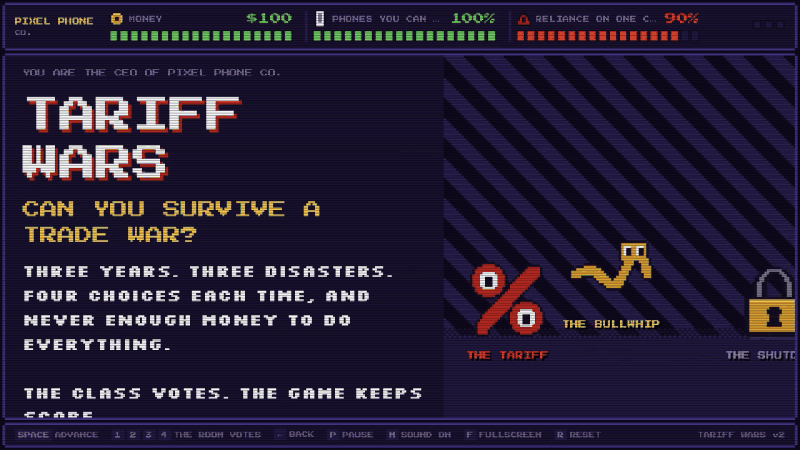
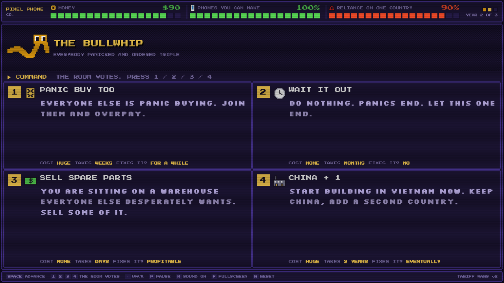
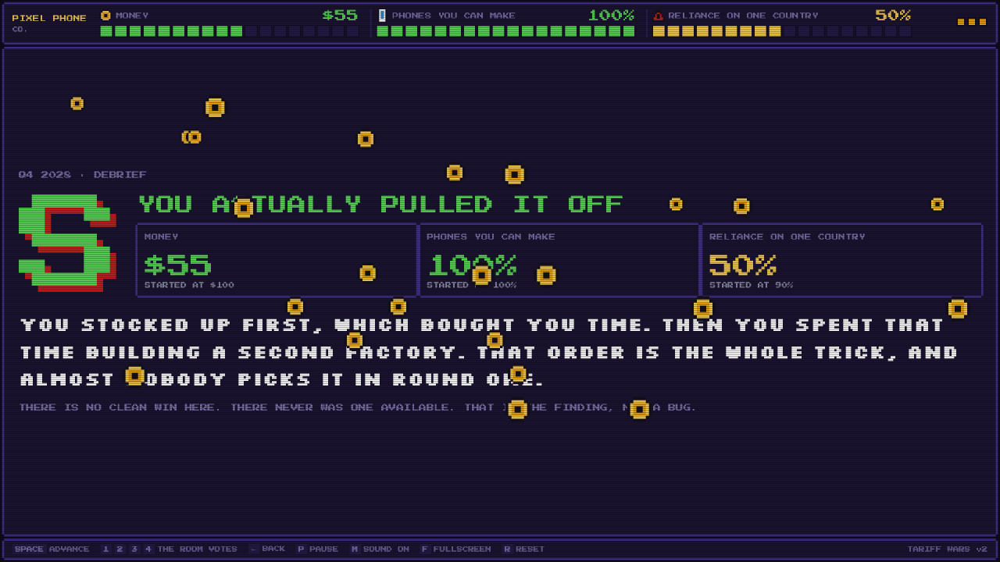

# TARIFF WARS

An 8-bit supply chain boss fight, built to be played live on a projector in front of a business class. You run a phone company. Three disasters hit over three years. The room votes on what to do, the game keeps score, and at the end it tells you whether you actually understood the lecture.

**Play it: [tariffwars.trevorrosato.com](https://tariffwars.trevorrosato.com)** (keyboard on a laptop, tap on a phone)



## Why this exists

It was built on the evening of August 5, 2026, for a group presentation called *Geopolitics, Trade Wars, and Supply Chain Disruptions* in an intro-level survey class. The title screen says what it's for: "a playable version of everything we just talked about." It's the whole group deck as a game, run off the classroom PC, with the class voting on every move.

The first version was about adhesive bandages, customs origin rulings and Section 301 tariffs. It was correctly rejected as way too hard for a survey class, and 45 minutes later it was rebuilt around the deck's own anchor example (the iPhone's journey: chips from Taiwan, cameras from Japan, assembly in China) using only words the class had just heard in the presentation. That rewrite is the third commit in this repo.

> TODO(Trevor): who Professor Whiting is, and the course name.
>
> TODO(Trevor): how the live run went. What the room picked, what rank it got, whether anyone tried to sell the company.

## How it plays

The game is 18 screens and takes about five minutes. Each year:

1. **A boss shows up.** THE TARIFF (a giant `%` whose rings are its eyes), THE BULLWHIP, THE SHUTDOWN.
2. **The room votes.** Four options, each tagged with what it costs, how long it takes and whether it fixes anything. Nobody has enough money to do everything.
3. **The result lands.** Your three meters take the hit: MONEY, PHONES YOU CAN MAKE, and RELIANCE ON ONE COUNTRY.
4. **Paths not taken.** What the other three options would have done, so the room sees the tradeoff instead of just its own outcome.
5. **One year later,** your last move comes back to bite you, or pays off.

The menus remember you. If you stocked up in year one, year two lets you sell spare parts into the panic. If you started a second factory, year three lets you switch production to it while the port is closed. If you did neither, those same buttons are a trap.



The grade is mostly about *what kind of company you built*, not the raw numbers. Across all 64 possible games: one S, five A, thirty B, twelve C, sixteen D. The single S path is **stock up, then China + 1, then use factory two**. Doing the same two good things in the other order gets you an A and an empty bank account, which is the point of the whole presentation.



## The economics

It's a five minute game for a survey class, so it's simplified on purpose, but the mechanics are meant to be things a professor would nod at:

- **A tariff is paid by the importer.** The game announces it a month early, so STOCK UP is front-loading: buying before it kicks in. Pay it yourself and it eats your margin every month. Raise prices and you keep your margin but lose customers to a cheaper phone.
- **The bullwhip effect.** Everyone over-orders at once, suppliers back up and prices spike. If you stocked up early, your warehouse is suddenly worth more than you paid for it. If you didn't, you panic buy at the worst price of the year along with everyone else, which is *why* it's the worst price of the year.
- **Just-in-time vs just-in-case.** A stockpile buys time. It never lowers your reliance on one country, and the game is built so it can't: no stocking move has any effect on that meter. The closing screen says this out loud.
- **China + 1.** A second factory is the real fix, and it takes two years. Started on day one it's ready when the port closes. Started during the shutdown it's two years too late, and money can't buy the time back.
- **Selling the company** drops your reliance to zero, because you don't make anything anymore. That's a D.

The closing screen boils it down to one table: stocking up starts in days and buys months; China + 1 starts in years and buys decades. Stock up first, then build.

## Presenting it

It was built for one deployment target: a classroom PC on a projector, possibly with no internet, driven by someone standing at the front of the room.

| Key | Does |
| --- | --- |
| `Space` / `Enter` / `→` | advance (or finish the text that's typing) |
| `1` `2` `3` `4` | record the room's vote |
| `←` / `Backspace` | step back; restores the meters to how they were |
| `P` | pause, for when someone asks a question |
| `M` | sound and music on / off (remembered) |
| `F` | fullscreen |
| `R` | start over (asks twice mid-game, so a stray key can't wipe the run) |

A clicker that sends `PageDown` / `PageUp` works too. The control bar at the bottom is also clickable, and on a phone it turns into NEXT / BACK / PAUSE / SOUND / RESTART buttons and you tap a card to vote.

Things that matter in a room full of people:

- **It's fully offline.** One HTML file, about 100 KB, with the fonts, sprites, sound and music all inside it. No network requests at all, ever. The build fails if one sneaks in.
- **It survives a refresh.** The run is saved on every screen, so an accidental reload puts you back where you were.
- **It fills whatever screen it's on.** 16:9, 4:3, ultrawide, a laptop, a phone. Text is sized to be read from the back of the room.
- **It can't strand the presenter.** If a screen ever throws, it's skipped instead of freezing.

### Getting it onto the classroom machine

Use all three, because classroom PCs are like that:

1. Open [tariffwars.trevorrosato.com](https://tariffwars.trevorrosato.com).
2. Email yourself [`public/index.html`](public/index.html).
3. Put [`public/index.html`](public/index.html) on a flash drive and double-click it. No server needed.

## How it's built

No framework, no engine, no dependencies. `build.js` stitches `src/` into one self-contained `public/index.html`:

- **`src/game.js`** holds every rule and every line of copy as plain data and pure functions: the menus, how they rewrite themselves based on what you did, the aftermath screens, the grade, and a headless `simulate()` that plays a whole game in the same order the screens do. The page and the tests both use it.
- **`src/sprites.js`** is 16 ASCII pixel maps rendered to inline SVG with `crispEdges`. Anything with curves or diagonals was drawn with a small rasterizer (`tools/gen-sprites.js`) instead of by hand, because hand-placed circles kept turning into toasters.
- **Backgrounds are tiled pixel maps too.** A true 45 degree staircase and a hard dither, generated at runtime. No gradients in the arena, because smooth gradients are the one thing an 8-bit machine can't do and they instantly read as fake.
- **Sound and music are Web Audio oscillators.** Square and triangle waves plus a noise channel, with a tiny step sequencer for the title theme and the voting clock. No audio files.
- **Fonts** are [Press Start 2P](https://fonts.google.com/specimen/Press+Start+2P) and [Silkscreen](https://fonts.google.com/specimen/Silkscreen), both under the SIL Open Font License, inlined as base64 WOFF2.

## Development

Needs Node 20 or newer. Nothing to install.

```bash
npm run build   # src/ -> public/index.html
npm test        # rules, balance, and the offline build
```

Edit `src/`, never `public/index.html`; it's generated. It is committed on purpose (so it can be emailed or put on a drive), and a test fails if it's stale, so rebuild before you commit.

The tests pin the things that are easy to break by accident: the 64-path grade distribution, the single S path, stocking up never touching reliance, the build making zero network requests, and the content rules for the class (no em dashes, none of the jargon the first version was rejected for). If you change any number in `src/game.js`, `npm test` tells you whether the game still says what it's supposed to say.

CI runs the tests and the build on every pull request. Vercel builds with `node build.js` and serves `public/`.
